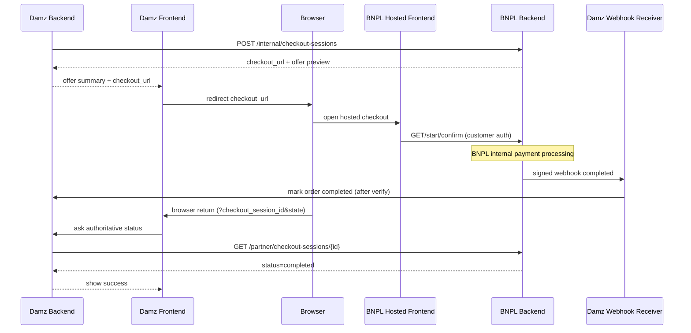

# Internal Partner ↔ BNPL Checkout Integration Guide

> این سند قرارداد integration برای **پارتنرهای داخلی / first-party** BNPL است (مثل Damz).  
> جزئیات Financial Core، PSP، payment provider و سایر سرویس‌های داخلی BNPL بخشی از این قرارداد نیستند.
>
> برای پارتنرهای بیرونی (مثل Digikala، Technolife) به [external-partner-checkout.md](external-partner-checkout.md) مراجعه کنید.

**مخاطب:** مهندسان Backend / Frontend / QA پارتنر داخلی · Cursor / AI Coding Agent در ریپوی پارتنر  
**مثال مرجع این سند:** Damz (مسیر `POST /api/v1/internal/checkout-sessions`)  
**Source of truth:** آخرین سورس BNPL (`checkoutsessionrs` / `checkoutsessionuc` / webhook / permission catalog / generated Swagger)  
**نسخه سند:** هم‌تراز با سورس فعلی repository (بدون تکیه بر مثال‌های قدیمی)

---

## Quick Start

1. یک‌بار: Return Destination و Webhook را ثبت کنید.
2. برای هر سفارش: با `POST /api/v1/internal/checkout-sessions` checkout بسازید.
3. Frontend Damz فقط `checkout_url` را باز کند (صفحه Hosted BNPL).
4. نتیجه authoritative فقط از Signed Webhook یا Inquiry API.
5. Browser Return را هرگز به‌عنوان پرداخت موفق تلقی نکنید.
6. Damz Backend هرگز `start` / `confirm` را صدا نزند.

ثابت‌های مثال این سند (در تمام curlها یکسان):

```text
merchant_order_id     = DAMZ-ORDER-20261005-1001
idempotency_key       = damz-attempt-20261005-1001-a
checkout_session_id   = 7c9e6679-7425-40de-944b-e07fc1f90ae7
online_store_id       = 6e1a2b3c-4d5e-4f6a-8b7c-9d0e1f2a3b4c
identity_subject_id   = 11111111-1111-1111-1111-111111111111
merchant_id           = 22222222-2222-2222-2222-222222222222
return_destination    = damz-web
merchant_state        = damz-cart-1001
requested_amount_minor= 120000000
currency              = IRR
```

---

## Architecture

از دید Damz، جریان کلی این است:

```text
Damz Backend
    |
    | Create Checkout (internal)
    v
BNPL
    |
    | checkout_url
    v
Damz Frontend
    |
    | Redirect browser
    v
BNPL Hosted Checkout
    |
    | Customer sees final terms
    | Customer confirms
    | BNPL handles payment internally
    v
BNPL
    |
    +---- Signed Webhook ----> Damz Backend
    |
    +---- Inquiry API <------ Damz Backend
    |
    v
Browser Return to Damz
```

قواعد معماری برای Damz:

- Damz قرارداد را برای Customer تأیید نمی‌کند.
- Damz Payment Provider انتخاب نمی‌کند.
- Damz به Financial Core دسترسی ندارد.
- Damz نتیجه پرداخت را از Browser Redirect معتبر تلقی نمی‌کند.
- Signed Webhook و Merchant Inquiry نتیجه authoritative BNPL هستند.
- `checkout_url` صفحه Hosted BNPL است (مثلاً `https://bnpl.example/checkout/{id}`)، نه REST API.

---

## Actors

### Damz Backend

مسئول:

```text
Create CheckoutSession (internal)
Configure return destination
Configure webhook
Query final checkout status (inquiry)
Consume signed webhook
Finalize Damz order
Cancel (when allowed)
```

### Damz Frontend

مسئول:

```text
Display initial BNPL offer summary (informational preview)
Redirect browser to checkout_url
Handle browser-return UX (processing page)
Ask Damz Backend for authoritative result
```

### BNPL Hosted Frontend

مسئول:

```text
Authenticate customer
Load checkout
Prepare / refresh offer if required (start)
Show final financing terms
Get explicit customer confirmation (confirm)
Redirect to payment page if required
Return user to merchant
```

**Damz نباید endpointهای Customer-facing مثل `start` یا `confirm` را از Backend خودش فراخوانی کند.**  
این APIها فقط برای BNPL Hosted Frontend هستند و بخشی از قرارداد Merchant سمت Damz نیستند.

---

## Authentication and Trusted Headers

BNPL خودش Identity Provider نیست. Gateway / Identity Service جلوی BNPL قرار دارد.

### آنچه Damz باید ارسال کند

- Credential واقعی Damz به **API Gateway** (مثلاً `Authorization: Bearer <DAMZ_ACCESS_TOKEN>`).
- Token باید برای هویت Merchant Damz صادر شده باشد و permissionهای لازم را داشته باشد.
- Token را فقط در Damz Backend نگه دارید؛ هرگز به Frontend ندهید.

### آنچه Gateway تزریق می‌کند (Damz نباید جعل کند)

BNPL از این headerهای trusted استفاده می‌کند:

| Header | نقش | Damz set کند؟ |
| --- | --- | --- |
| `x-auth-subject-id` | هویت Merchant (`merchant_profiles.merchant_id`) برای partner/internal merchant routes | خیر — Gateway |
| `x-auth-tenant-id` | Tenant | خیر — Gateway |
| `x-auth-context-id` | Business context | خیر — Gateway |
| `x-auth-permissions` | لیست permissionهای مجاز (comma-separated) | خیر — Gateway |
| `X-Trace-Id` / `X-Request-Id` / `X-Correlation-Id` | Observability (اختیاری؛ در نبود، BNPL تولید می‌کند) | اختیاری |

اگر Damz مستقیماً به BNPL پشت Gateway دسترسی داشته باشد و این headerها را خودش بسازد، قرارداد امنیتی نقض می‌شود. در curlهای این سند فقط `Authorization` نشان داده می‌شود.

### Permissions لازم برای Damz

| Permission | کاربرد |
| --- | --- |
| `bnpl:checkout-sessions:create:merchant` | Create internal + Cancel merchant |
| `bnpl:decisions:create:on-behalf` | **الزامی** برای `POST /internal/checkout-sessions` (همراه با create) |
| `bnpl:checkout-sessions:read:merchant` | Inquiry |
| `bnpl:checkout-return-destinations:manage:merchant` | ثبت/به‌روزرسانی return destination |
| `bnpl:checkout-webhooks:manage:merchant` | ثبت/چرخش webhook |

نکته: credential معمولی create/read/cancel به‌تنهایی webhook یا return URL را تغییر نمی‌دهد.

---

## API Inventory (Damz-facing)

| Method | Path | Caller | When | Required Permission | Idempotent? | Purpose |
| --- | --- | --- | --- | --- | --- | --- |
| `PUT` | `/api/v1/partner/return-destinations/{destination_name}` | Damz Backend | One-time / when return URL changes | `bnpl:checkout-return-destinations:manage:merchant` | Upsert | ثبت مقصد browser return |
| `PUT` | `/api/v1/partner/webhook-destination` | Damz Backend | One-time / rotate secret / change URL | `bnpl:checkout-webhooks:manage:merchant` | Upsert | ثبت webhook |
| `POST` | `/api/v1/internal/checkout-sessions` | Damz Backend | هر خرید BNPL | `create:merchant` **و** `decisions:create:on-behalf` | بله (با `idempotency_key`) | ساخت + ارزیابی فوری + `checkout_url` + offer |
| `GET` | `/api/v1/partner/checkout-sessions/{checkout_session_id}` | Damz Backend | بعد از return / polling / verify webhook | `bnpl:checkout-sessions:read:merchant` | بله (read-only) | Inquiry authoritative |
| `POST` | `/api/v1/partner/checkout-sessions/{checkout_session_id}/cancel` | Damz Backend | لغو قبل از پذیرش مالی | `bnpl:checkout-sessions:create:merchant` | بله اگر از قبل `canceled` | لغو merchant |

### Hosted BNPL APIs — فقط برای فهم Flow (Damz صدا نزند)

| Method | Path | Caller واقعی | Permission |
| --- | --- | --- | --- |
| `GET` | `/api/v1/checkout-sessions/{id}` | BNPL Hosted Frontend | `bnpl:checkout-sessions:read:self` |
| `POST` | `/api/v1/checkout-sessions/{id}/start` | BNPL Hosted Frontend | `bnpl:checkout-sessions:start:self` |
| `POST` | `/api/v1/checkout-sessions/{id}/confirm` | BNPL Hosted Frontend | `bnpl:checkout-sessions:start:self` |
| `POST` | `/api/v1/checkout-sessions/{id}/cancel` | BNPL Hosted Frontend (customer) | `bnpl:checkout-sessions:start:self` |
| `GET` | `/api/v1/checkout-sessions/{id}/return` | BNPL Hosted Frontend | `bnpl:checkout-sessions:read:self` |

> این APIها بخشی از integration contract سمت Damz Backend نیستند.  
> Damz Backend هرگز `start` یا `confirm` را فراخوانی نکند.

مسیر `POST /api/v1/partner/checkout-sessions` (external partner بدون `identity_subject_id`) برای merchantهای خارجی است. Damz به‌عنوان first-party trusted باید از **`/internal/checkout-sessions`** استفاده کند.

---

## One-time Damz Configuration

### 7.1 Return Destination

```http
PUT /api/v1/partner/return-destinations/{destination_name}
```

#### `destination_name`

- Pattern: lowercase kebab-case `^[a-z0-9]+(?:-[a-z0-9]+)*$`
- Length: 1..64
- Whitespace یا uppercase silently اصلاح نمی‌شود.

```text
valid:
  damz-web
  default
  mobile-app

invalid:
  Damz-Web
  damz_web
  damz--
  ../foo
```

#### Request body

| Field | Type | Required | Meaning |
| --- | --- | --- | --- |
| `return_url` | string | yes | URL مطلق browser return؛ max 2048 |
| `enabled` | bool | no | omit → مقدار قبلی حفظ می‌شود؛ روی create پیش‌فرض `true` |

#### Validation واقعی `return_url`

- absolute `http` یا `https` با hostname
- بدون userinfo، query، fragment
- بدون leading/trailing whitespace و control chars
- در production/staging: فقط HTTPS (`RequireHTTPS`)
- در development: HTTP برای localhost مجاز است

اگر destination با `enabled=false` ذخیره شود، در create به‌عنوان «ثبت‌نشده» دیده می‌شود و خطای `error.merchant_return_destination_is_not_registered` برمی‌گردد.

#### Response

```json
{
  "data": {
    "destination_name": "damz-web",
    "return_url": "https://damz.example/checkout/bnpl/return",
    "enabled": true
  },
  "meta": {
    "status": "success",
    "code": "MERCHANT_RETURN_DESTINATION_UPSERTED"
  }
}
```

#### cURL

```bash
curl -X PUT \
  'https://api.bnpl.example/api/v1/partner/return-destinations/damz-web' \
  -H 'Authorization: Bearer <DAMZ_ACCESS_TOKEN>' \
  -H 'Content-Type: application/json' \
  -d '{
    "return_url": "https://damz.example/checkout/bnpl/return",
    "enabled": true
  }'
```

---

## Webhook Configuration

```http
PUT /api/v1/partner/webhook-destination
```

هر merchant فقط **یک** webhook endpoint دارد. Checkout create هرگز webhook URL نمی‌گیرد.

| Field | Type | Required | Meaning |
| --- | --- | --- | --- |
| `webhook_url` | string | yes | absolute http(s)، بدون userinfo/query/fragment، max 2048 |
| `signing_secret` | string | first register: yes; update: optional | write-only؛ 32..512 bytes؛ omit = حفظ secret قبلی؛ مقدار جدید = rotate |
| `enabled` | bool | no | omit → حفظ مقدار؛ روی create پیش‌فرض `true` |

Response هرگز `signing_secret` را برنمی‌گرداند:

```json
{
  "data": {
    "webhook_url": "https://damz.example/webhooks/bnpl/checkout",
    "enabled": true
  },
  "meta": {
    "status": "success",
    "code": "MERCHANT_WEBHOOK_DESTINATION_UPSERTED"
  }
}
```

```bash
curl -X PUT \
  'https://api.bnpl.example/api/v1/partner/webhook-destination' \
  -H 'Authorization: Bearer <DAMZ_ACCESS_TOKEN>' \
  -H 'Content-Type: application/json' \
  -d '{
    "webhook_url": "https://damz.example/webhooks/bnpl/checkout",
    "signing_secret": "replace-with-a-secret-at-least-32-bytes-long!!",
    "enabled": true
  }'
```

اگر `enabled=false` باشد، BNPL delivery را انجام نمی‌دهد (destination برای dispatcher غیرفعال است).

---

## Checkout Creation — Main Damz API

```http
POST /api/v1/internal/checkout-sessions
```

ایجاد session + ارزیابی فوری برای `identity_subject_id` + برگرداندن `checkout_url` و offer.  
این پاسخ پذیرش شرایط توسط Customer نیست؛ Confirm نهایی فقط روی Hosted BNPL است.

### Request fields

| Field | Type | Required? | Meaning | Validation | Example |
| --- | --- | --- | --- | --- | --- |
| `online_store_id` | uuid | yes | فروشگاه آنلاین Damz در BNPL | must belong to authenticated merchant | `6e1a2b3c-4d5e-4f6a-8b7c-9d0e1f2a3b4c` |
| `merchant_order_id` | string | yes | شناسه سفارش Damz | 1..256 | `DAMZ-ORDER-20261005-1001` |
| `idempotency_key` | string | no* | کلید عملیات create | max 256؛ اگر خالی → برابر `merchant_order_id` | `damz-attempt-20261005-1001-a` |
| `identity_subject_id` | uuid | yes | Identity subject مشتری (نه internal PK) | required روی internal | `11111111-1111-1111-1111-111111111111` |
| `customer_reference` | string | no | handle اختیاری مشتری Damz | max 256 | `damz-user-42` |
| `return_destination` | string | yes | نام نمادین از پیش ثبت‌شده | kebab-case 1..64 | `damz-web` |
| `merchant_state` | string | no | opaque؛ روی browser return به‌صورت `state` برمی‌گردد | max 256 | `damz-cart-1001` |
| `requested_amount_minor` | uint64 | yes | مبلغ سفارش به **minor unit** ارز | ≥ 1 | `120000000` |
| `currency` | string | yes | ISO code پشتیبانی‌شده | فعلاً `IRR` / `EUR` / `USD` | `IRR` |

\* توصیه قوی: همیشه `idempotency_key` صریح بفرستید.

### توضیح فیلدهای کلیدی

#### `merchant_order_id`

- مرجع کسب‌وکاری سفارش Damz است.
- Scope uniqueness عملیاتی با `idempotency_key` و وضعیت attempt تعیین می‌شود:
  - یک order می‌تواند چند **attempt** داشته باشد (بعد از `canceled` / `expired` / `unavailable`) با `idempotency_key` جدید.
  - فقط یک attempt فعال (`open` / `confirming` / `processing`) در یک زمان.
  - بعد از `completed`، attempt جدید با key جدید برای همان order رد می‌شود (`IDEMPOTENCY_CONFLICT`).

#### `idempotency_key`

- Retry همان عملیات create → **همان key**.
- Attempt / عملیات جدید → **key جدید**.
- با `merchant_order_id` یکی نیست.
- Replay با همان key و همان terms → HTTP `200` + همان session.
- Replay با key یکسان ولی terms متفاوت → `IDEMPOTENCY_CONFLICT` (session ذخیره شده تغییر نمی‌کند).
- Replay internal با customer متفاوت → همان conflict.

#### `identity_subject_id`

- شناسه خارجی Identity Service است (`customer_profiles.identity_subject_id`).
- فقط روی مسیر internal و با permission `bnpl:decisions:create:on-behalf` پذیرفته می‌شود.
- Damz می‌تواند از طرف مشتری شناخته‌شده‌اش ارزیابی اولیه بگیرد؛ Confirm نهایی همچنان روی Hosted BNPL است.

#### `return_destination`

- نام نمادین؛ نه URL.
- باید از قبل با `PUT .../return-destinations/{name}` و `enabled=true` ثبت شده باشد.

#### `merchant_state`

- Opaque متعلق به Damz.
- Round-trip می‌شود: روی browser return به‌صورت query param `state` و در webhook به‌صورت `merchant_state` (اگر غیرخالی).

#### `requested_amount_minor` و `currency`

- مبلغ به minor unit ارز اعلام‌شده است.
- برای Damz معمولاً `currency = "IRR"` (Iranian Rial).
- این سند تومان/ریال را تبدیل نمی‌کند؛ همان عدد و currency توافق‌شده با BNPL را بفرستید و در inquiry/webhook همان را verify کنید.

---

## Complete Create Checkout cURL

```bash
curl --request POST \
  --url 'https://api.bnpl.example/api/v1/internal/checkout-sessions' \
  --header 'Authorization: Bearer <DAMZ_ACCESS_TOKEN>' \
  --header 'Content-Type: application/json' \
  --data '{
    "online_store_id": "6e1a2b3c-4d5e-4f6a-8b7c-9d0e1f2a3b4c",
    "merchant_order_id": "DAMZ-ORDER-20261005-1001",
    "idempotency_key": "damz-attempt-20261005-1001-a",
    "identity_subject_id": "11111111-1111-1111-1111-111111111111",
    "customer_reference": "damz-user-42",
    "return_destination": "damz-web",
    "merchant_state": "damz-cart-1001",
    "requested_amount_minor": 120000000,
    "currency": "IRR"
  }'
```

- HTTP `201`: session جدید ساخته و evaluate شده (`CHECKOUT_SESSION_CREATED`).
- HTTP `200`: idempotent replay همان session.

---

## Create Checkout Response

Envelope استاندارد:

```json
{
  "data": { "...": "..." },
  "meta": {
    "status": "success",
    "code": "CHECKOUT_SESSION_CREATED",
    "message": "...",
    "status_code": 201,
    "timestamp": "2026-10-05T10:00:00Z",
    "trace_id": "...",
    "request_id": "..."
  }
}
```

### `data` (internal create)

| Field | Meaning |
| --- | --- |
| `checkout_session_id` | شناسه checkout برای inquiry/cancel/persist |
| `status` | معمولاً `open`؛ اگر financing نشود `unavailable` |
| `checkout_url` | URL صفحه Hosted؛ بدون parse/reconstruct استفاده شود |
| `evaluation_generation` | نسخه offer دیده‌شده (informational برای Damz) |
| `offer` | خلاصه تأمین مالی (preview) |

#### `offer` وقتی `outcome = "approved"`

| Field | Meaning |
| --- | --- |
| `outcome` | `approved` |
| `available_credit_minor` | اعتبار در دسترس در زمان ارزیابی |
| `requested_amount_minor` | مبلغ درخواستی |
| `approved_financed_amount_minor` | مبلغ تأمین‌شده |
| `required_down_payment_amount_minor` | پیش‌پرداخت لازم (gap خرید − اعتبار/تأمین) |
| `currency` | ارز |
| `offer_expires_at` | انقضای offer |
| `installment_count` | تعداد اقساط |
| `payable_now_amount_minor` | مبلغ قابل پرداخت فوری برای فعال‌سازی (اگر لازم باشد) |
| `total_payable_amount_minor` | جمع کل قابل پرداخت طبق برنامه |
| `installments[]` | `installment_order`, `due_at`, `total_amount_minor` |
| `checkout_action` | `{ type, payment_required, payment_amount_minor }` |

`checkout_action.type`:

- `confirm_and_pay` → بعد از Confirm، پرداخت فوری لازم است (`payment_required=true`).
- `confirm_purchase` → Confirm بدون redirect پرداخت مشتری (ActivationAfterMerchantFunding / merchant funding).

#### وقتی `outcome = "denied"`

فقط `outcome` برمی‌گردد؛ بقیه فیلدهای مالی omit می‌شوند (نه صفر).

### فرق سه مبلغ مهم

| مقدار | معنا | معادل دیگری نیست |
| --- | --- | --- |
| `required_down_payment_amount_minor` | پیش‌پرداخت / gap تأمین | ≠ لزوماً `payable_now` |
| `payable_now_amount_minor` | مبلغی که برای فعال‌سازی باید همین حالا پرداخت شود (طبق plan) | ممکن است شامل پیش‌پرداخت + بخش اول قسط باشد |
| `installments[0].total_amount_minor` | مبلغ کل قسط اول در جدول | جداگانه نمایش دهید؛ با دو مورد بالا یکی فرض نکنید |

برای UI Damz: `payable_now_amount_minor` را به‌عنوان «قابل پرداخت اکنون» و جدول `installments` را به‌عنوان برنامه اقساط نشان دهید.

### نمونه response (approved)

```json
{
  "data": {
    "checkout_session_id": "7c9e6679-7425-40de-944b-e07fc1f90ae7",
    "status": "open",
    "checkout_url": "https://bnpl.example/checkout/7c9e6679-7425-40de-944b-e07fc1f90ae7",
    "evaluation_generation": 1,
    "offer": {
      "outcome": "approved",
      "available_credit_minor": 200000000,
      "requested_amount_minor": 120000000,
      "approved_financed_amount_minor": 120000000,
      "required_down_payment_amount_minor": 0,
      "currency": "IRR",
      "offer_expires_at": "2026-10-05T12:00:00Z",
      "installment_count": 4,
      "payable_now_amount_minor": 30000000,
      "total_payable_amount_minor": 120000000,
      "installments": [
        {
          "installment_order": 1,
          "due_at": "2026-10-05T10:00:00Z",
          "total_amount_minor": 30000000
        }
      ],
      "checkout_action": {
        "type": "confirm_and_pay",
        "payment_required": true,
        "payment_amount_minor": 30000000
      }
    }
  },
  "meta": {
    "status": "success",
    "code": "CHECKOUT_SESSION_CREATED",
    "status_code": 201
  }
}
```

---

## `evaluation_generation`

مثال: `evaluation_generation = 3` یعنی Customer نسخه ۳ offer را دیده است.  
اگر شرایط عوض شود و generation به ۴ برسد، Customer باید شرایط جدید را دوباره ببیند و Confirm کند.

از دید Damz:

> این فیلد informational است و Damz نباید Confirm را خودش انجام دهد.

Final Confirm فقط توسط BNPL Hosted Frontend با ارسال همان `evaluation_generation` انجام می‌شود. اگر stale باشد، Hosted پاسخ `reconfirm_required` می‌گیرد — Damz درگیر این مسیر نیست.

---

## Damz Frontend Behavior

بعد از Create، Damz می‌تواند خلاصه informational نشان دهد:

```text
Purchase amount
Available BNPL credit
Installment count
Payable now
Installment schedule
```

دکمه باید معنایی مشابه **Continue with BNPL** داشته باشد — نه «Confirm Contract»، نه «Pay»، نه «Activate Contract».

سپس:

```javascript
window.location.assign(checkout_url);
```

- `checkout_url` را parse، rewrite یا از روی `checkout_session_id` دوباره نسازید.
- Credential BNPL را در Frontend نگذارید.
- Merchant APIها را فقط از Damz Backend صدا بزنید.

---

## Hosted BNPL Flow — For Understanding Only

> این APIها بخشی از integration contract سمت Damz Backend نیستند.

```text
Browser enters checkout_url
        ↓
BNPL authenticates customer
        ↓
GET /api/v1/checkout-sessions/{id}     (read-only; binds/evaluates نمی‌کند)
        ↓
اگر offer آماده نباشد / نیاز به refresh باشد:
POST .../start                         (prepare / refresh offer)
        ↓
BNPL displays final offer
        ↓
Customer confirms
        ↓
POST .../confirm  { "evaluation_generation": N }
```

نکته سورس فعلی: فیلد صریح `preparation_required` در GET وجود ندارد. GET فقط projection است؛ اگر offer هنوز آماده نباشد `offer` ممکن است absent باشد و Hosted باید `start` را صدا بزند. مسیر internal create از قبل evaluate کرده، اما Hosted همچنان مالک Confirm است و در صورت نیاز `start` را برای refresh صدا می‌زند.

---

## Payment Continuation (Hosted-only public shape)

بعد از Confirm موفق توسط Hosted، اگر پرداخت مشتری لازم باشد، response عمومی فعلی این شکل را دارد (بدون شناسه‌های داخلی payment):

```json
{
  "checkout_session_id": "7c9e6679-7425-40de-944b-e07fc1f90ae7",
  "status": "processing",
  "reconfirm_required": false,
  "evaluation_generation": 1,
  "payment_required": true,
  "redirect_url": "https://pay.example/session/abc",
  "expires_at": "2026-10-05T12:30:00Z"
}
```

اگر payment لازم نباشد (ActivationAfterMerchantFunding / merchant funding):

```json
{
  "payment_required": false,
  "status": "completed"
}
```

(همراه با سایر فیلدهای confirm response در Hosted.)

**Damz این response را مصرف نمی‌کند.** Damz فقط webhook/inquiry را می‌بیند.

> نکته: response Confirm هنوز فیلد `contract` (id/status) برای Hosted دارد. Damz نباید به آن وابسته شود و نباید این API را صدا بزند. جزئیات بیشتر در بخش Public Contract Leakage.

---

## Normal Customer vs Direct Activation

### Normal customer

```text
Customer confirms
       ↓
BNPL requires customer action (payment_required)
       ↓
Browser redirects
       ↓
BNPL receives authoritative internal result
       ↓
Checkout completed
```

### Direct activation customer

```text
Customer confirms
       ↓
No customer payment redirect
       ↓
BNPL completes internal financial acceptance
       ↓
Checkout completed
```

از دید Damz هر دو یکی هستند:

```text
status = completed
```

Damz نباید بفهمد یا وابسته باشد که BNPL کدام مسیر پرداخت داخلی را استفاده کرده است.

---

## How Damz Knows the Purchase Is Actually Complete

فقط دو کانال authoritative:

1. **Signed Webhook** با `event_type = bnpl.checkout.completed.v1` و `data.status = "completed"`
2. **Inquiry API**  
   `GET /api/v1/partner/checkout-sessions/{checkout_session_id}` با `status = "completed"`

> وجود Browser Return یا query parameter هیچ‌وقت به معنای پرداخت موفق نیست.

---

## Inquiry API

```http
GET /api/v1/partner/checkout-sessions/{checkout_session_id}
```

نقش: inquiry سبک IPG.

```bash
curl \
  'https://api.bnpl.example/api/v1/partner/checkout-sessions/7c9e6679-7425-40de-944b-e07fc1f90ae7' \
  -H 'Authorization: Bearer <DAMZ_ACCESS_TOKEN>'
```

### Response واقعی

```json
{
  "data": {
    "checkout_session_id": "7c9e6679-7425-40de-944b-e07fc1f90ae7",
    "merchant_order_id": "DAMZ-ORDER-20261005-1001",
    "status": "completed",
    "amount_minor": 120000000,
    "currency": "IRR",
    "completed_at": "2026-10-05T10:30:12Z"
  },
  "meta": {
    "status": "success",
    "code": "CHECKOUT_SESSION_RETRIEVED",
    "status_code": 200
  }
}
```

- `completed_at` فقط وقتی status=`completed` پر می‌شود.
- Offer / credit / شناسه‌های پرداخت داخلی در inquiry نیستند.
- Session متعلق به merchant دیگر → `404` (نه `403`) تا probe نشود.
- Open ولی گذشته از `expires_at` ممکن است به‌صورت read-only `expired` project شود بدون write.

### Damz validation checklist

قبل از finalize سفارش:

```text
checkout_session_id matches
merchant_order_id matches
amount_minor matches expected order amount
currency matches
status == completed
```

اگر status غیر `completed` بود، سفارش را complete نکنید.

---

## Webhook Contract

### Event types

| event_type | معنی |
| --- | --- |
| `bnpl.checkout.completed.v1` | خرید پذیرفته و قرارداد فعال شد |
| `bnpl.checkout.canceled.v1` | لغو merchant یا customer |
| `bnpl.checkout.expired.v1` | انقضای handoff |
| `bnpl.checkout.unavailable.v1` | تأمین مالی قابل ارائه نبود |

### Headers واقعی delivery

| Header | محتوا |
| --- | --- |
| `Content-Type` | `application/json` |
| `User-Agent` | `bnpl-webhook/1` |
| `X-BNPL-Webhook-Id` | event id پایدار بین retryها — برای dedupe |
| `X-BNPL-Webhook-Timestamp` | Unix seconds همین attempt |
| `X-BNPL-Webhook-Signature` | `v1=<hex(HMAC-SHA256)>` |
| `X-BNPL-Webhook-Event` | `event_type` (اگر در پیام موجود باشد) |

### Envelope JSON واقعی

```json
{
  "event_id": "session:bnpl.checkout.completed.v1:completed",
  "event_type": "bnpl.checkout.completed.v1",
  "event_version": "1",
  "producer": "bnpl-backend",
  "occurred_at": "2026-10-05T10:30:12Z",
  "data": {
    "checkout_session_id": "7c9e6679-7425-40de-944b-e07fc1f90ae7",
    "merchant_order_id": "DAMZ-ORDER-20261005-1001",
    "merchant_id": "22222222-2222-2222-2222-222222222222",
    "status": "completed",
    "amount_minor": 120000000,
    "currency": "IRR",
    "completed_at": "2026-10-05T10:30:12Z",
    "merchant_state": "damz-cart-1001"
  }
}
```

برای non-completed، `completed_at` omit می‌شود. برای canceled ممکن است `reason` باشد.

### Webhook verification (الگوریتم واقعی BNPL)

Canonical signed payload (bytes):

```text
v1
<event-id>
<unix-timestamp-decimal>
<body-bytes>
```

یعنی: `v1` + LF + eventID + LF + timestamp + LF + raw body.

سپس:

```text
HMAC-SHA256(signing_secret, signed_payload)
Signature header = "v1=" + hex(digest)
```

قواعد Damz:

1. **Raw body را قبل از JSON parse نگه دارید** و همان bytes را برای verify استفاده کنید.
2. `X-BNPL-Webhook-Id` را با event id داخل body تطبیق دهید.
3. `X-BNPL-Webhook-Timestamp` را در signed payload استفاده کنید (همان مقدار header).
4. مقایسه signature را constant-time انجام دهید.
5. Timestamp stale را رد کنید. BNPL روی سمت receiver عدد tolerance ثابتی enforce نمی‌کند؛ Damz باید یک پنجره معقول خودش (مثلاً چند دقیقه) اعمال کند — عدد دقیق قرارداد BNPL نیست.
6. بعد از rotate secret: اگر rotation همزمان پشتیبانی نمی‌شود، در پنجره cutover ممکن است نیاز به پذیرش secret قبلی و جدید داشته باشید (BNPL در response secret برنمی‌گرداند؛ rotation با ارسال secret جدید در PUT است).

---

## Webhook Idempotency

Delivery می‌تواند چندبار تکرار شود. `X-BNPL-Webhook-Id` / `event_id` بین retryها پایدار است.

```text
if event_id already processed:
    return 2xx

verify signature against raw body

validate checkout_session_id / merchant_order_id / amount_minor / currency

if status == completed:
    apply Damz order completion once (idempotent)

store event_id as processed

return 2xx
```

توصیه: به‌روزرسانی وضعیت سفارش و persist شدن `event_id` در یک transaction انجام شود.  
پاسخ غیر-2xx باعث retry از سمت BNPL می‌شود.

---

## Browser Return

BNPL کاربر را به `return_url` ثبت‌شده برمی‌گرداند و این queryها را اضافه می‌کند:

| Param | منبع |
| --- | --- |
| `checkout_session_id` | همیشه |
| `state` | فقط اگر `merchant_state` غیرخالی باشد (echo همان مقدار) |

مثال:

```text
https://damz.example/checkout/bnpl/return?checkout_session_id=7c9e6679-7425-40de-944b-e07fc1f90ae7&state=damz-cart-1001
```

> هشدار: وجود Browser Return یا query parameter هیچ‌وقت به معنای پرداخت موفق نیست.

Frontend Damz بعد از return:

1. صفحه Processing نشان دهد.
2. از Damz Backend نتیجه authoritative بخواهد (inquiry / وضعیت سفارش ذخیره‌شده از webhook).
3. موفقیت پرداخت را از URL حدس نزند.

---

## Cancellation

```http
POST /api/v1/partner/checkout-sessions/{checkout_session_id}/cancel
```

Body ندارد.

```bash
curl --request POST \
  --url 'https://api.bnpl.example/api/v1/partner/checkout-sessions/7c9e6679-7425-40de-944b-e07fc1f90ae7/cancel' \
  --header 'Authorization: Bearer <DAMZ_ACCESS_TOKEN>'
```

Response:

```json
{
  "data": {
    "checkout_session_id": "7c9e6679-7425-40de-944b-e07fc1f90ae7",
    "status": "canceled",
    "return_url": "https://damz.example/checkout/bnpl/return?checkout_session_id=7c9e6679-7425-40de-944b-e07fc1f90ae7&state=damz-cart-1001"
  },
  "meta": {
    "status": "success",
    "code": "CHECKOUT_SESSION_CANCELED"
  }
}
```

| وضعیت فعلی | نتیجه |
| --- | --- |
| `open` (بدون contract پذیرفته‌شده ناامن) | cancel می‌شود |
| `canceled` | موفقیت idempotent + همان return URL |
| `confirming` / `processing` | `409` — payment in progress |
| `open` ولی contract از قبل accepted و outcome مبهم | `409` — must resolve first |
| `completed` / `expired` / `unavailable` | `409` — not cancelable |
| `open` ولی expired | ممکن است به expired منتقل شود و caller خطای expired بگیرد |

بعد از پذیرش مالی / وضعیت‌های در جریان، cancel مجاز نیست.

---

## Status State Machine

وضعیت‌های merchant-visible:

```text
open | confirming | processing | completed | canceled | expired | unavailable
```

| Status | Meaning for Damz | Fulfill order? | Retry create? | Terminal? |
| --- | --- | --- | --- | --- |
| `open` | در انتظار ادامه Customer روی Hosted | خیر | نه برای همان attempt؛ wait | خیر |
| `confirming` | Confirm در حال اجرا | خیر | خیر | خیر |
| `processing` | نتیجه نهایی هنوز نرسیده | خیر — poll / wait webhook | خیر | خیر |
| `completed` | خرید توسط BNPL پذیرفته شد | بله (بعد از verify) | خیر (order بسته است) | بله |
| `canceled` | لغو شده | خیر | attempt جدید با idempotency_key جدید | بله |
| `expired` | مهلت handoff تمام شده | خیر | attempt جدید با key جدید | بله |
| `unavailable` | تأمین مالی ارائه نشد | خیر | attempt جدید با key جدید | بله |

---

## Error Handling

شکل خطا:

```json
{
  "code": "INVALID_ARGUMENT",
  "message": "...",
  "trace_id": "...",
  "details": {
    "fields": ["return_destination"],
    "violations": [
      {
        "code": "NOT_REGISTERED",
        "message": "...",
        "fields": ["return_destination"]
      }
    ]
  }
}
```

| HTTP | BNPL Error Code | معنی / MessageKey نمونه | Damz Action | Retry? |
| --- | --- | --- | --- | --- |
| 400 | `INVALID_ARGUMENT` | ورودی نامعتبر / destination ثبت‌نشده یا disabled | fix input | خیر |
| 401 | `UNAUTHORIZED` | auth context نیست | refresh token / gateway | مشروط |
| 403 | `FORBIDDEN` | permission یا merchant/store ownership | fix IAM / store mapping | خیر |
| 404 | `RESOURCE_NOT_FOUND` | checkout پیدا نشد یا متعلق به merchant دیگر | stop / check id | خیر |
| 409 | `IDEMPOTENCY_CONFLICT` | `error.merchant_order_id_conflicts_with_an_existing_checkout_session` | terms/key/customer را اصلاح کن | خیر با همان payload متفاوت |
| 409 | `CONFLICT` | expired / not continuable / not cancelable / payment in progress / concurrent create | inquiry؛ برای cancel صبر یا stop | مشروط |
| 422 | `VALIDATION_FAILED` | validation لایه bind | fix fields | خیر |
| 502 | `PAYMENT_PROVIDER_ERROR` | خطای لایه پرداخت (عمومی) | معمولاً نه برای Damz create | مشروط عملیاتی |
| 503 | `SERVICE_UNAVAILABLE` | سرویس در دسترس نیست | backoff | بله |
| 500 | `INTERNAL_ERROR` | خطای داخلی | backoff + support | مشروط |

سناریوهای رایج create:

- unknown/disabled return destination → `INVALID_ARGUMENT` / `error.merchant_return_destination_is_not_registered`
- customer/store/merchant eligibility failures → `FORBIDDEN` یا conflict/unavailable بر اساس مسیر
- denied financing → ممکن است session با `status=unavailable` و `offer.outcome=denied` برگردد (success path) — سفارش را fulfill نکنید

---

## Retry Rules

### Create Checkout

- Timeout / network ambiguity → **همان** `idempotency_key` را retry کنید.
- عملیات/attempt جدید → `idempotency_key` **جدید**.
- `IDEMPOTENCY_CONFLICT` را با تغییر خاموش terms retry نکنید.

### Inquiry

GET به‌صورت امن retryپذیر است.

### Webhook

Duplicate را با `event_id` idempotent بپذیرید و 2xx برگردانید.

### Cancel

- اگر قبلاً `canceled` باشد → موفقیت idempotent.
- اگر `confirming`/`processing` → retry کور نکنید؛ inquiry کنید.
- بعد از resolve شدن وضعیت، بر اساس inquiry تصمیم بگیرید.

---

## Security Requirements for Damz

- Access token فقط server-side.
- Merchant APIها فقط از Damz Backend.
- `checkout_url` را trusted output بدانید ولی parse/reconstruct نکنید.
- `checkout_session_id` به‌تنهایی proof of payment نیست.
- Signed webhook را verify کنید؛ secret را log نکنید.
- Browser return را trust نکنید.
- قبل از complete: amount / currency / merchant_order_id را verify کنید.
- Trusted headers (`x-auth-*`) را جعل نکنید.
- Credential را به Frontend ندهید.
- به شناسه‌ها یا جزئیات داخلی پرداخت BNPL وابسته نشوید.

---

## Complete Happy-path Sequence (Normal Customer)



---

## Direct Activation Sequence

```text
Damz Backend → POST /internal/checkout-sessions
Browser → BNPL Hosted Checkout
Customer confirms
BNPL internally accepts financial obligation
BNPL → status completed
BNPL → Damz signed webhook (completed)
Damz → optional inquiry verify
```

Integration Damz تفاوتی با مسیر normal ندارد: منتظر `completed` از webhook/inquiry بمانید.

---

## Failure Scenarios

| Scenario | Damz action |
| --- | --- |
| Create timeout | Retry با همان `idempotency_key`؛ سپس persist نتیجه |
| Create retried با همان key | انتظار HTTP 200 + همان session |
| Checkout expired قبل از confirm | سفارش را complete نکنید؛ attempt جدید با key جدید در صورت نیاز |
| Offer changed قبل از confirm | Hosted reconfirm می‌کند؛ Damz کاری نکند مگر inquiry بگوید unavailable/expired |
| Customer cancels | webhook/inquiry → `canceled`؛ سفارش BNPL را لغو شده بدانید |
| Merchant cancels | `POST .../cancel` وقتی هنوز مجاز است |
| Browser closes payment page | polling inquiry؛ ممکن است `processing` یا بعداً `completed`/`open` |
| Browser never returns | webhook + inquiry کافی است؛ به return وابسته نباشید |
| Webhook delivery fails | BNPL retry می‌کند؛ Damz با inquiry همگام شود |
| Webhook arrives twice | dedupe روی `event_id`؛ 2xx |
| Inquiry = `processing` | fulfill نکنید؛ دوباره poll |
| Inquiry = `completed` | بعد از validate amount/order → fulfill |
| Browser returned ولی inquiry نه completed | UI processing؛ fulfill نکنید |
| BNPL unavailable (503) | backoff + retry امن |

---

## Damz Backend Implementation Checklist

```text
[ ] Add BNPL HTTP client (server-side only)
[ ] Configure base URL + access token securely
[ ] Add UpsertReturnDestination
[ ] Add UpsertWebhookDestination
[x] Removed — all merchants use Partner Create + customer token flow
[ ] Add Inquiry (GetPartnerStatus)
[ ] Add CancelByMerchant
[ ] Persist checkout_session_id against Damz order
[ ] Persist idempotency_key per attempt
[ ] Persist expected amount_minor + currency
[ ] Persist merchant_state
[ ] Persist BNPL status
[ ] Add webhook HTTP endpoint
[ ] Verify HMAC with raw body (v1 canonical string)
[ ] Store processed_event_ids (unique)
[ ] Validate amount/currency/order before completing purchase
[ ] Never complete from browser return alone
[ ] Handle processing (do not fulfill)
[ ] Handle completed idempotently
[ ] Handle canceled/expired/unavailable
[ ] Never call start/confirm from Damz Backend
[ ] Never depend on Financial Core / PSP identifiers
```

---

## Damz Frontend Implementation Checklist

```text
[ ] Show BNPL offer returned by Damz backend (informational)
[ ] CTA label like "Continue with BNPL"
[ ] Use checkout_url without reconstructing it
[ ] Redirect with window.location.assign(checkout_url)
[ ] Implement Damz browser-return page
[ ] Never infer payment success from return URL
[ ] Ask Damz backend for current order result
[ ] Show processing until backend confirms completion
[ ] Do not embed BNPL merchant credentials
```

---

## Data Damz Must Persist

| Data | Required? | Notes |
| --- | --- | --- |
| Damz Order ID (`merchant_order_id`) | required | business key |
| BNPL `checkout_session_id` | required | inquiry/cancel/webhook correlate |
| `idempotency_key` | required | retry-safe create |
| expected `amount_minor` | required | verify webhook/inquiry |
| `currency` | required | verify |
| `merchant_state` | recommended | correlate return UX |
| BNPL checkout status | required | state machine |
| processed webhook `event_id`s | required | idempotency |
| `created_at` / `updated_at` | recommended | ops/debug |
| offer preview snapshot | optional | UI only |

Financial Core identifiers را ذخیره نکنید — Damz نباید آن‌ها را ببیند.

---

## End-to-End Example

### 1) Register destination

```bash
curl -X PUT \
  'https://api.bnpl.example/api/v1/partner/return-destinations/damz-web' \
  -H 'Authorization: Bearer <DAMZ_ACCESS_TOKEN>' \
  -H 'Content-Type: application/json' \
  -d '{
    "return_url": "https://damz.example/checkout/bnpl/return",
    "enabled": true
  }'
```

### 2) Register webhook

```bash
curl -X PUT \
  'https://api.bnpl.example/api/v1/partner/webhook-destination' \
  -H 'Authorization: Bearer <DAMZ_ACCESS_TOKEN>' \
  -H 'Content-Type: application/json' \
  -d '{
    "webhook_url": "https://damz.example/webhooks/bnpl/checkout",
    "signing_secret": "replace-with-a-secret-at-least-32-bytes-long!!",
    "enabled": true
  }'
```

### 3–4) Create checkout → receive `checkout_url`

(همان curl بخش Create؛ response شامل  
`checkout_session_id=7c9e6679-7425-40de-944b-e07fc1f90ae7` و  
`checkout_url=https://bnpl.example/checkout/7c9e6679-7425-40de-944b-e07fc1f90ae7`)

### 5) Redirect

```javascript
window.location.assign(
  "https://bnpl.example/checkout/7c9e6679-7425-40de-944b-e07fc1f90ae7"
);
```

### 6) BNPL Hosted Checkout

Customer authenticate → (optional start) → confirm → internal payment processing.

### 7) Webhook completed

Headers + body طبق بخش Webhook؛ `data.status = "completed"`،  
`amount_minor = 120000000`، `currency = "IRR"`،  
`merchant_order_id = DAMZ-ORDER-20261005-1001`.

### 8) Inquiry verification

```bash
curl \
  'https://api.bnpl.example/api/v1/partner/checkout-sessions/7c9e6679-7425-40de-944b-e07fc1f90ae7' \
  -H 'Authorization: Bearer <DAMZ_ACCESS_TOKEN>'
```

### 9) Mark Damz order completed

فقط پس از validate کامل webhook و/یا inquiry.

### 10) Browser returns

```text
https://damz.example/checkout/bnpl/return?checkout_session_id=7c9e6679-7425-40de-944b-e07fc1f90ae7&state=damz-cart-1001
```

Frontend وضعیت را از Backend می‌گیرد؛ از URL نتیجه نمی‌سازد.

---

## API Reference (خلاصه قرارداد)

همه responseهای موفق: `{ "data": ..., "meta": ... }`.  
همه خطاها: `{ "code", "message", "trace_id", "details?" }`.

جزئیات path/method/permission در جدول Inventory و بخش‌های بالا.

---

## Swagger Cross-Check

تطبیق با `gen/swagger/swagger.yaml` و handler/DTO واقعی:

| Path | Method | Request schema | Response schema | Permission (کد) | نتیجه |
| --- | --- | --- | --- | --- | --- |
| `/api/v1/partner/return-destinations/{destination_name}` | PUT | `UpsertReturnDestinationRequestSchema` | `ReturnDestinationSuccessSchema` | manage return destinations | منطبق |
| `/api/v1/partner/webhook-destination` | PUT | `UpsertWebhookDestinationRequestSchema` | `WebhookDestinationSuccessSchema` | manage webhooks | منطبق |
| *(removed)* | — | — | — | use Partner Create | — |
| `/api/v1/partner/checkout-sessions/{id}` | GET | path id | `StatusSuccessSchema` | read merchant | منطبق |
| `/api/v1/partner/checkout-sessions/{id}/cancel` | POST | path id | `CancelSuccessSchema` | create merchant | منطبق |

### Known Documentation Mismatches

| مورد | واقعیت کد | سند/آرتیفکت قدیمی یا گمراه‌کننده |
| --- | --- | --- |
| `doc/api.md` می‌گوید Authentication و OpenAPI پیاده نشده | Auth middleware + permission + Swagger تولیدشده موجود است | `doc/api.md` کهنه است |
| Swagger پارامترهای `x-auth-*` را به‌عنوان headerهای client required نشان می‌دهد | در معماری واقعی Gateway آن‌ها را inject می‌کند؛ Damz فقط credential Gateway را می‌فرستد | مثال‌های Swagger برای caller پشت Gateway گمراه‌کننده است |
| بعضی متن‌های قدیمی `checkout.completed` می‌گویند | event type واقعی `bnpl.checkout.completed.v1` است | نام کوتاه را event_type فرض نکنید |
| Swagger روی `return_destination` pattern regex را کامل منعکس نمی‌کند | کد REST/UseCase/DB الگوی kebab-case را enforce می‌کند | validation واقعی از کد سخت‌گیرانه‌تر است |

---

## Public Contract Leakage / Remaining Issue

| مورد | Severity | توضیح | Impact on Damz |
| --- | --- | --- | --- |
| Confirm Hosted هنوز `contract.id` / `contract.status` برمی‌گرداند | Medium (Hosted boundary) | روی API customer-facing است، نه partner inquiry | Damz نباید این API را صدا بزند یا به `contract` وابسته شود |
| شناسه‌های Financial Core / PSP در partner inquiry و lifecycle webhook فعلی دیده نمی‌شوند | OK | مرز فعلی تمیز است | وابستگی نسازید |

---

## BNPL Issues Found While Producing This Guide

| Severity | File | Problem | Impact on Damz | Recommended BNPL fix |
| --- | --- | --- | --- | --- |
| Low | `doc/api.md` | وضعیت Authentication/OpenAPI کهنه | گیج‌شدن تیم‌ها | به‌روزرسانی وضعیت سند |
| Low | Swagger annotations (`x-auth-*` required) | مرز Gateway vs client credential مبهم است | ممکن است Damz header جعل کند | مستندسازی Gateway-only + مثال Bearer |
| Medium | Hosted `confirm` response (`contract` object) | contract id روی public customer response | اگر کسی اشتباهی merchant را به آن وصل کند | حذف/جدا کردن projection merchant از Hosted |
| Info | Webhook timestamp tolerance | BNPL عدد ثابت tolerance برای receiver تعریف نکرده | Damz باید policy محلی انتخاب کند | توصیه رسمی tolerance در docs |

هیچ Business Codeای در تولید این guide تغییر نکرده است.

---

## Cursor Implementation Instructions for Damz

> Based solely on the API contract in this document, inspect the Damz repository and implement the BNPL integration without introducing BNPL-internal concepts (Financial Core, PSP, provider selection, payment intent/session/invoice ids, collection obligation ids).

Implement exactly:

```text
[ ] Server-side BNPL client with Bearer auth to Gateway
[ ] One-time return destination upsert
[ ] One-time webhook destination upsert + secret storage
[ ] Create checkout via POST /api/v1/internal/checkout-sessions
[ ] Persist checkout_session_id, idempotency_key, amount, currency, status
[ ] Frontend: show offer preview; Continue with BNPL → assign(checkout_url)
[ ] Webhook receiver: raw-body HMAC verify (v1 LF id LF ts LF body)
[ ] Dedupe on event_id
[ ] Inquiry GET for authoritative confirmation / reconciliation
[ ] Complete Damz order only when status=completed AND amount/currency/order match
[ ] Treat browser return as UX only
[ ] Cancel via partner cancel when business rules require and status allows
[ ] Never call /checkout-sessions/{id}/start or /confirm from Damz
[ ] Never forge x-auth-* trusted headers
[ ] Unit/integration tests for idempotent create, webhook dedupe, inquiry validation
```

اگر repository Damz الگوی HTTP client / webhook / order state machine دارد، همان‌ها را گسترش دهید؛ abstraction جدید حول مفاهیم داخلی BNPL نسازید.
