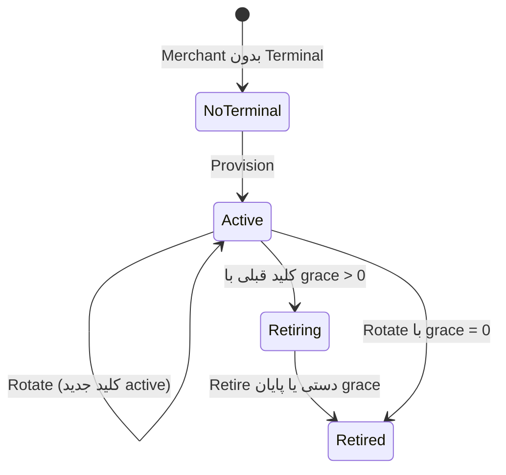

# فلوهای Merchant Terminal و API Key

> **مخاطب:** تیم Backend، پنل Merchant، QA و Partner Integration  
> **مرجع کد:** `pkg/core/usecase/merchantterminaluc`، `pkg/adapter/restful/gin/merchantterminalrs`، `pkg/adapter/restful/gin/middleware/partner_terminal_auth.go`  
> **تاریخ:** ۲۰۲۶-۱۱-۱۰

## دو سطح کاملاً جدا

| سطح | احراز هویت | مسیرها | کار |
| --- | --- | --- | --- |
| **پنل Merchant** | JWT Gateway → `x-auth-subject-id` = `external_merchant_id` | `/api/v1/merchant/terminal/**` | Provision / Get / Rotate / Retire |
| **Backend پارتنر** | `X-Terminal-Id` + `X-API-Key` | `/api/v1/partner/**` | Authenticate برای Create/Status/Cancel Checkout و مدیریت Destination |

پنل مرورگری نباید با API Key روی `/partner/**` صدا بزند. کلید فقط برای Backend پارتنر است.

## فایل‌های فلو

| فایل | فلو |
| --- | --- |
| [provision.md](provision.md) | ایجاد Terminal و اولین API Key |
| [get.md](get.md) | مشاهده وضعیت Terminal بدون کلید خام |
| [rotate.md](rotate.md) | چرخش API Key با دورهٔ Grace |
| [retire.md](retire.md) | پایان زودهنگام Grace برای کلید قبلی |
| [authenticate.md](authenticate.md) | احراز هویت Partner با Terminal ID + API Key |
| [issuance-scrub.md](issuance-scrub.md) | پاک‌سازی ciphertext کلیدهای قابل‌Replay |

اسکریپت smoke (بدون حذف این مستندات): [`scripts/merchant-terminal/`](../../../scripts/merchant-terminal/).

## مفاهیم مشترک

- **یک Merchant = حداکثر یک Terminal** (unique روی `external_merchant_id`).
- **Show-once:** plaintext `api_key` فقط در پاسخ Provision/Rotate (و Replay همان درخواست در TTL) برمی‌گردد؛ `GET` هرگز کلید را نمی‌دهد.
- **ذخیره:** فقط HMAC verifier (pepper شده) + ciphertext رمزشده برای Replay کوتاه‌مدت.
- **وضعیت Credential:** `active` → `retiring` → `retired` (یا مستقیم `retired` وقتی grace=0).
- **Permission پنل:** `bnpl:merchant-terminals:manage:merchant`.
- **Permission پارتنر (seed در Provision):** create/read checkout، manage webhook destination، manage return destination.

## تنظیمات پیش‌فرض (local / `.env.example`)

| کلید | پیش‌فرض |
| --- | --- |
| `MERCHANT_TERMINAL_ROTATION_DEFAULT_GRACE_PERIOD` | `24h` |
| `MERCHANT_TERMINAL_ROTATION_MAX_GRACE_PERIOD` | `168h` (۷ روز) |
| `MERCHANT_TERMINAL_ISSUANCE_DELIVERY_TTL` | `24h` |

## چرخهٔ عمر خلاصه

