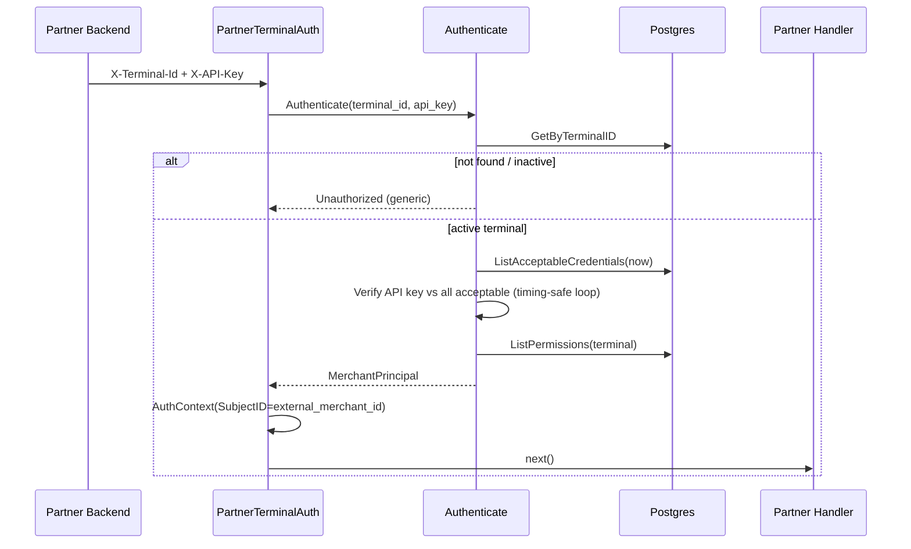

# فلو Authenticate (Partner: Terminal ID + API Key)

> برگشت به [فهرست](README.md)

## هدف

درخواست‌های `/api/v1/partner/**` را با `X-Terminal-Id` و `X-API-Key` احراز کند و `MerchantPrincipal` + `AuthContext` بسازد. این مسیر JWT Gateway و هدرهای `X-Auth-*` را **اعتماد نمی‌کند**.

## نقطهٔ ورود HTTP

Middleware: `PartnerTerminalAuth` روی گروه `/api/v1/partner`.

| Header | نقش |
| --- | --- |
| `X-Terminal-Id` | شناسهٔ عمومی عددی Terminal (canonical decimal، بدون trim) |
| `X-API-Key` | Secret صادرشده در Provision/Rotate (مقایسهٔ exact) |

هر هدر باید **دقیقاً یک‌بار** باشد. Missing / duplicate / malformed / wrong → همان خطای عمومی Unauthorized.

## مراحل



## قواعد پذیرش کلید

Credential قابل‌قبول در زمان `now`:

- وضعیت `active`، یا
- وضعیت `retiring` با `retire_at > now`

مقایسه روی **همه** Credentialهای قابل‌قبول انجام می‌شود و در اولین match متوقف نمی‌شود (کاهش نشت زمانی موقعیت).

اگر Terminal پیدا نشود یا inactive باشد، یک Hash دور انداخته می‌شود تا هزینه نزدیک به رد کلید اشتباه باشد.

## خروجی Principal

```text
ExternalMerchantID  ← مالک Terminal
TerminalID
CredentialID / CredentialVersion  ← کلیدی که match شد
Permissions         ← فقط از DB (FilterKnown)؛ نه از header و نه hard-code در Authenticate
```

Permissionهای اولیه در [Provision](provision.md) seed می‌شوند، مثلاً:

- `bnpl:checkout-sessions:create:merchant`
- `bnpl:checkout-sessions:read:merchant`
- `bnpl:checkout-webhooks:manage:merchant`
- `bnpl:checkout-return-destinations:manage:merchant`

مدیریت Terminal (provision/rotate/retire) هرگز در این مجموعه نیست.

## خطاها

| علت واقعی | پاسخ عمومی |
| --- | --- |
| هدر ناقص / تکراری / خالی | Unauthorized یکسان |
| terminal_id نامعتبر | Unauthorized یکسان |
| Terminal نیست / inactive | Unauthorized یکسان |
| API key اشتباه / منقضی | Unauthorized یکسان |
| Pepper مفقود برای verifier | Unauthorized عمومی + تشخیص داخلی برای اپراتور |

کلید خام، hash و pepper هرگز لاگ یا در پیام عمومی نمی‌آیند.

## مسیرهای استفاده‌کننده

بعد از Authenticate موفق، Handlerهای Partner مثل Create/Cancel/Status Checkout و Upsert Destination از `MerchantPrincipal` / `AuthContext` استفاده می‌کنند. مستند Partner: [partner-checkout.md](../partner-checkout.md).

## مرجع کد

- Use case: `pkg/core/usecase/merchantterminaluc/authenticate.go`
- Middleware: `pkg/adapter/restful/gin/middleware/partner_terminal_auth.go`
- Principal: `pkg/core/merchantterminal/principal.go`
