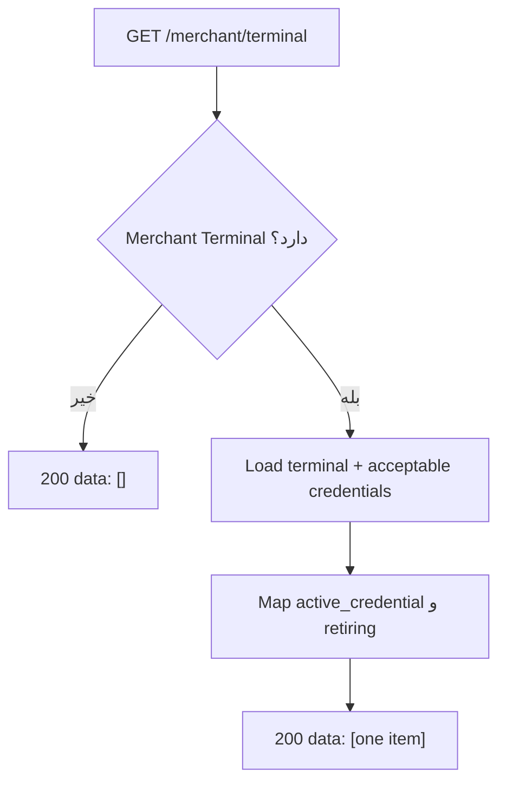

# فلو Get (مشاهده Terminal بدون API Key)

> برگشت به [فهرست](README.md)

## هدف

وضعیت Terminal و metadata Credentialهای قابل‌قبول را برای پنل Merchant نشان دهد، بدون افشای plaintext کلید.

## API

| | |
| --- | --- |
| Method / Path | `GET /api/v1/merchant/terminal` |
| Auth | Gateway JWT → `external_merchant_id` |
| Permission | `bnpl:merchant-terminals:manage:merchant` |
| Body | ندارد |

## رفتار



- فهرست خالی = HTTP **200** با `data: []` (نه 404).
- حداکثر یک Terminal در مدل فعلی؛ پاسخ یا خالی است یا یک آیتم.
- فقط Credentialهای `active` و `retiring` که هنوز تا `retire_at` پذیرفته می‌شوند در پاسخ می‌آیند.
- فیلد `api_key` **وجود ندارد**.

## پاسخ نمونه

```json
[
  {
    "external_merchant_id": "8e1a2b3c-4d5e-4f6a-8b7c-9d0e1f2a3b4c",
    "terminal_id": "4829174650293817",
    "status": "active",
    "created_at": "2026-08-09T12:00:00Z",
    "updated_at": "2026-08-10T12:00:00Z",
    "active_credential": {
      "credential_id": "…",
      "version": 2,
      "activated_at": "2026-08-10T12:00:00Z"
    },
    "retiring": {
      "credential_id": "…",
      "version": 1,
      "retire_at": "2026-08-11T12:00:00Z"
    }
  }
]
```

`retiring` اختیاری است؛ فقط وقتی کلید قبلی هنوز در Grace باشد دیده می‌شود.

## کاربرد پنل

| سناریو UI | اقدام |
| --- | --- |
| `data: []` | CTA «ایجاد Terminal» → [provision.md](provision.md) |
| فقط `active_credential` | نمایش `terminal_id`؛ دکمه Rotate / بدون کلید |
| `active` + `retiring` | هشدار «کلید قبلی تا retire_at معتبر است» + دکمه Retire زودهنگام |

## مرجع کد

- Use case: `pkg/core/usecase/merchantterminaluc/get.go`
- HTTP: `pkg/adapter/restful/gin/merchantterminalrs/get.go`
