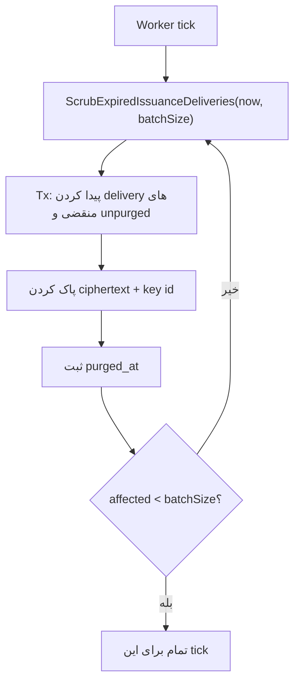

# فلو Issuance Scrub (پاک‌سازی Secret قابل‌Replay)

> برگشت به [فهرست](README.md)

## هدف

بعد از اتمام `issuance_delivery_ttl`، ciphertext کلید داخل `merchant_terminal_issuance_deliveries` را پاک کند تا plaintext دیگر حتی با Decrypt قابل بازیابی نباشد، در حالی که ردیف به‌عنوان **tombstone Idempotency** باقی می‌ماند.

بدون این tombstone، استفادهٔ مجدد از همان `Idempotency-Key` می‌توانست کلید دوم بسازد؛ با tombstone، Replay بعد از scrub همچنان Conflict می‌دهد.

## چه زمانی صدا زده می‌شود

Task پیکربندی‌شده:

| | |
| --- | --- |
| Handler | `merchant_terminal_issuance_scrub` |
| Env نمونه | `TASK_MERCHANT_TERMINAL_ISSUANCE_SCRUB_*` |
| پیش‌فرض local | `ENABLED=false`، interval پیشنهادی `5m` |

Worker باید `ScrubExpiredIssuanceDeliveries` را با `batchSize` مثبت صدا بزند و تا وقتی تعداد scrub شده کمتر از batch است تکرار کند.

## مراحل یک Batch

## اثر روی فلوهای دیگر

| فلو | بعد از scrub |
| --- | --- |
| Idempotent Provision/Rotate با همان Key | دیگر نمی‌تواند plaintext برگرداند → Conflict / replay unavailable |
| Authenticate | بی‌تأثیر (verifier روی credential است، نه delivery) |
| Get | بی‌تأثیر |

TTL پیش‌فرض local برای delivery: **۲۴ ساعت** (`MERCHANT_TERMINAL_ISSUANCE_DELIVERY_TTL`).

## مرجع کد

- Use case: `pkg/core/usecase/merchantterminaluc/cleanup.go`
- Repo: `pkg/adapter/db/postgres/merchantterminalrp` → `ScrubExpiredIssuanceDeliveries`
- Config task: `.env.example` بخش `TASK_MERCHANT_TERMINAL_ISSUANCE_SCRUB_*`
