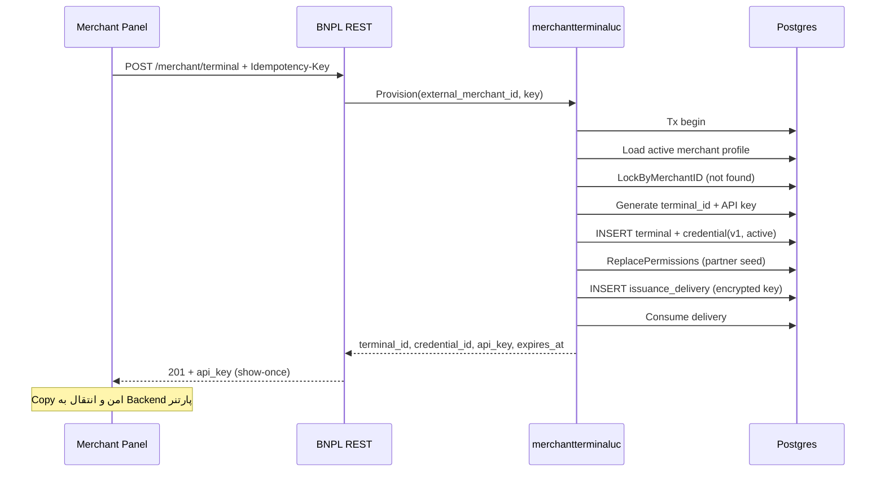

# فلو Provision (ایجاد Terminal و اولین API Key)

> برگشت به [فهرست](README.md)

## هدف

برای Merchant احرازشدهٔ پنل، یک Terminal بسازد، `terminal_id` عمومی تولید کند، اولین Credential را فعال کند، Permissionهای پارتنر را seed کند، و **یک‌بار** plaintext `api_key` را برگرداند.

## API

| | |
| --- | --- |
| Method / Path | `POST /api/v1/merchant/terminal` |
| Auth | Gateway JWT → `x-auth-subject-id` = `external_merchant_id` |
| Permission | `bnpl:merchant-terminals:manage:merchant` |
| Header الزامی | `Idempotency-Key` (۱..۱۲۸ کاراکتر) |
| Body | خالی / بدون فیلد الزامی |

## پیش‌شرط‌ها

- پروفایل Merchant وجود داشته باشد و `status=active` باشد.
- Merchant هنوز Terminal نداشته باشد (یا همین درخواست با همان Idempotency-Key در پنجرهٔ Replay باشد).

## مراحل (موفق، اولین بار)



جزئیات داخلی:

1. Merchant از AuthContext خوانده می‌شود (نه از path/body).
2. `Idempotency-Key` با پیشوند داخلی `provision:` ذخیره می‌شود.
3. `terminal_id` عددی بزرگ تولید می‌شود؛ در UI به‌صورت **string** نگه دارید.
4. API Key با HMAC pepper شده hash می‌شود؛ plaintext فقط در SecretBox برای Replay TTL رمز می‌شود.
5. Permissionهای اولیهٔ پارتنر روی `merchant_terminal_permissions` نوشته می‌شوند.

## Idempotent Replay

اگر Merchant از قبل Terminal دارد **و** همان `Idempotency-Key` به delivery همان Provision اشاره کند **و** هنوز داخل `issuance_delivery_ttl` باشد **و** credential مربوطه هنوز `active` باشد:

- همان `terminal_id` و همان `api_key` برمی‌گردد.
- فیلد `replayed=true`.
- HTTP معمولاً `200`.

در غیر این صورت:

| وضعیت | نتیجه |
| --- | --- |
| Terminal از قبل هست، key دیگر / بدون delivery | Conflict «already provisioned» |
| Key با fingerprint متفاوت | `IDEMPOTENCY_CONFLICT` |
| Replay بعد از TTL / scrub / rotate | `IDEMPOTENCY_CONFLICT` / unavailable |
| Merchant غیرفعال | Forbidden / not active |
| پروفایل نیست | Not found |

## پاسخ نمونه (شکل)

```json
{
  "external_merchant_id": "8e1a2b3c-4d5e-4f6a-8b7c-9d0e1f2a3b4c",
  "terminal_id": "4829174650293817",
  "credential_id": "7f3d9a10-2b4c-4e5f-9a6b-1c2d3e4f5a6b",
  "credential_version": 1,
  "api_key": "bnpl_…",
  "created_at": "2026-08-09T12:00:00Z",
  "api_key_replayable_until": "2026-08-10T12:00:00Z",
  "replayed": false
}
```

## نکات امنیتی UI

- کلید را یک‌بار Reveal/Copy کنید؛ در Redux، LocalStorage، Analytics ذخیره نکنید.
- بعد از بستن UI، بازیابی فقط با [Rotate](rotate.md) ممکن است.
- `GET` بعدی کلید را برنمی‌گرداند → [get.md](get.md).

## مرجع کد

- Use case: `pkg/core/usecase/merchantterminaluc/provision.go`
- HTTP: `pkg/adapter/restful/gin/merchantterminalrs/provision.go`
- Permissions seed: `pkg/core/merchantterminal/permissions.go`
