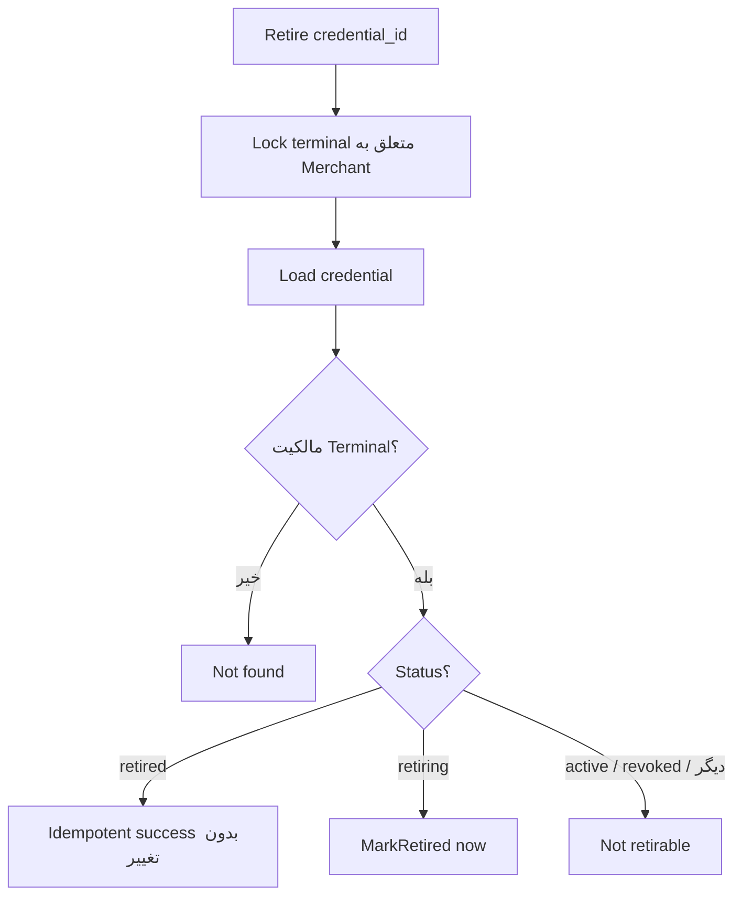

# فلو Retire (پایان زودهنگام Grace)

> برگشت به [فهرست](README.md)

## هدف

یک Credential در وضعیت `retiring` را **فوراً** به `retired` ببرد تا دیگر برای Authenticate پذیرفته نشود، بدون اینکه منتظر `retire_at` بمانید.

جایگزینی کلید active از مسیر Retire انجام نمی‌شود؛ برای آن باید [Rotate](rotate.md) زد.

## API

| | |
| --- | --- |
| Method / Path | `POST /api/v1/merchant/terminal/credentials/{credential_id}/retire` |
| Auth | Gateway JWT → `external_merchant_id` |
| Permission | `bnpl:merchant-terminals:manage:merchant` |
| Idempotency-Key | لازم نیست |
| Body | ندارد |

`credential_id` معمولاً از فیلد `retiring.credential_id` در پاسخ Rotate یا Get می‌آید.

## مراحل



## قواعد

| وضعیت فعلی | نتیجه |
| --- | --- |
| `retiring` | `retired`؛ `retired_at = now` |
| `retired` | موفقیت بدون تغییر (Idempotent) |
| `active` | خطا — از Rotate استفاده کنید |
| متعلق به Terminal دیگر / نیست | Not found |

## پاسخ نمونه

```json
{
  "credential_id": "7f3d9a10-2b4c-4e5f-9a6b-1c2d3e4f5a6b",
  "version": 1,
  "retired_at": "2026-08-10T13:00:00Z"
}
```

## سناریوی عملیاتی

1. Rotate با grace ۲۴ ساعته → Partner کلید جدید را Deploy می‌کند.
2. وقتی Confirm شد که فقط کلید جدید در Production است، پنل Retire را روی `retiring.credential_id` می‌زند.
3. از این لحظه Authenticate با کلید قدیمی Unauthorized است.

اگر Retire نزنید، در پایان `retire_at` هم کلید قدیمی دیگر پذیرفته نمی‌شود؛ Retire فقط زمان را جلو می‌اندازد. نرمال‌سازی دیرهنگام DB روی سطرهای منقضی‌شده هنگام Rotate بعدی هم انجام می‌شود.

## مرجع کد

- Use case: `pkg/core/usecase/merchantterminaluc/retire.go`
- HTTP: `pkg/adapter/restful/gin/merchantterminalrs/retire.go`
