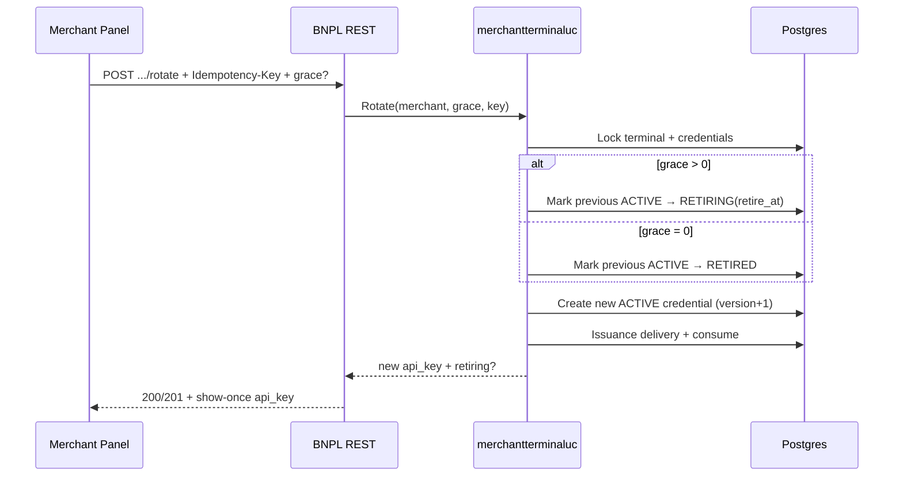

# فلو Rotate (چرخش API Key)

> برگشت به [فهرست](README.md)

## هدف

برای Terminal موجود یک Credential جدید `active` صادر کند و کلید قبلی را برای مدت Grace همچنان بپذیرد (یا فوراً بازنشسته کند اگر grace=0)، تا Partner بتواند بدون قطع سرویس کلید جدید را Deploy کند.

## API

| | |
| --- | --- |
| Method / Path | `POST /api/v1/merchant/terminal/credentials/rotate` |
| Auth | Gateway JWT → `external_merchant_id` |
| Permission | `bnpl:merchant-terminals:manage:merchant` |
| Header الزامی | `Idempotency-Key` |
| Body اختیاری | `{"grace_period_seconds": 3600}` |

### Grace

| ورودی | معنای مؤثر |
| --- | --- |
| Body خالی / بدون فیلد | `DefaultGrace` (local: **۲۴ ساعت**) |
| `grace_period_seconds: N` | `N` ثانیه، باید `0 ≤ N ≤ MaxGrace` (local max: **۱۶۸ ساعت**) |
| `0` | کلید قبلی **فوراً** `retired` می‌شود؛ در پاسخ `retiring` نیست |

حذف فیلد و ارسال صریح همان Default از نظر Idempotency یک درخواست محسوب می‌شوند (fingerprint روی effective grace است).

## پیش‌شرط‌ها

- Terminal وجود داشته باشد و `active` باشد.
- Credential `retiring` قابل‌قبول دیگری در جریان نباشد (در غیر این صورت Conflict «rotation in progress»).
- Credential `retiring` که graceاش تمام شده، در همین Tx به `retired` نرمال می‌شود و Rotate ادامه می‌یابد.

## مراحل (موفق، غیر Replay)



## Idempotent Replay

همان `Idempotency-Key` + همان effective grace:

- تا وقتی delivery منقضی نشده و credential جدید هنوز `active` است → همان `api_key` با `replayed=true`.
- Key با grace مؤثر متفاوت → `IDEMPOTENCY_CONFLICT`.
- بعد از Rotate بعدی که این credential را جایگزین کرده → Replay رد می‌شود (stale).

پیشوند داخلی کلید: `rotate:` (جدا از namespaceٔ Provision).

## پاسخ نمونه

```json
{
  "external_merchant_id": "…",
  "terminal_id": "4829174650293817",
  "credential_id": "…",
  "credential_version": 2,
  "api_key": "bnpl_…",
  "activated_at": "2026-08-10T12:00:00Z",
  "retiring": {
    "credential_id": "…",
    "version": 1,
    "retire_at": "2026-08-11T12:00:00Z"
  },
  "api_key_replayable_until": "2026-08-11T12:00:00Z",
  "replayed": false
}
```

## رفتار Partner در دورهٔ Grace

تا `retire_at` هر دو کلید (قدیمی retiring و جدید active) برای [Authenticate](authenticate.md) پذیرفته می‌شوند. بعد از آن فقط کلید جدید.

برای قطع زودهنگام کلید قبلی → [retire.md](retire.md).

## مرجع کد

- Use case: `pkg/core/usecase/merchantterminaluc/rotate.go`
- HTTP: `pkg/adapter/restful/gin/merchantterminalrs/rotate.go`
- Config: `usecases.merchant_terminal.rotation.*` در `configs/runtime.yaml`
